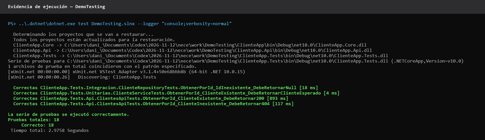

# DemoTesting

## Sobre el proyecto

Este proyecto muestra de forma sencilla cómo realizar pruebas unitarias junto con pruebas de integración y pruebas para una API en .NET.

El trabajo está basado en el proyecto [PruebasSoftware](https://github.com/eruanoc5/PruebasSoftware). Se creó una copia independiente para agregar las pruebas solicitadas sin modificar el repositorio original.

## Herramientas utilizadas

El proyecto utiliza .NET 10 y ASP.NET Core para la API. Las pruebas están hechas con xUnit y Moq. También se utiliza SQLite para trabajar con una base de datos temporal durante las pruebas y `HttpClient` junto con `WebApplicationFactory` para comprobar el comportamiento de la API.

## Organización del proyecto

La carpeta `ClienteApp` contiene los modelos junto con el repositorio y la lógica del servicio. La carpeta `ClienteApp.Api` contiene la API y sus controladores. La carpeta `ClienteApp.Tests` contiene todas las pruebas. Las capturas de los resultados se encuentran en `docs/evidencias`.

## Prueba unitaria

La prueba `ObtenerPorId_ClienteExistente_DebeRetornarClienteEsperado` comprueba el método `ClienteService.ObtenerPorId`.

En esta prueba se utiliza Moq para simular el repositorio. El servicio recibe un cliente preparado para la prueba y luego se comprueba que devuelve ese mismo cliente. También se verifica que el repositorio se consulte una sola vez mediante `Times.Once`.

## Prueba de integración

La prueba `ObtenerPorId_IdInexistente_DebeRetornarNull` utiliza el servicio y el repositorio reales.

Durante la prueba se crea una base de datos SQLite temporal. Después se consulta un identificador que no existe y se comprueba que el resultado sea nulo. La base temporal se elimina al terminar para no dejar archivos ni modificar los datos de desarrollo.

## Pruebas de API

La prueba `ObtenerPorId_ClienteExistente_DebeRetornar200` registra un cliente en la base temporal y luego lo consulta mediante la API. Si el cliente existe la respuesta debe ser `200 OK`.

La prueba `ObtenerPorId_ClienteInexistente_DebeRetornar404` consulta un identificador que no existe. En este caso la API debe responder con `404 Not Found`.

Las dos pruebas utilizan un `HttpClient` creado por `WebApplicationFactory`. De esta forma la API se ejecuta en un entorno de prueba y utiliza una base SQLite independiente.

## Cómo ejecutar las pruebas

Para ejecutar el proyecto es necesario tener instalado el SDK de .NET 10.

Desde la carpeta principal del repositorio se deben ejecutar estos comandos.

```powershell
dotnet restore
dotnet test DemoTesting.slnx --logger "console;verbosity=normal"
```

## Resultado de la ejecución

Se ejecutaron todas las pruebas del proyecto y las 18 finalizaron correctamente.

```text
Pruebas totales: 18
Correcto: 18
Error: 0
```

## Evidencias

La siguiente captura muestra las pruebas solicitadas y el resumen de la ejecución.



La captura con la salida completa está disponible en [docs/evidencias/suite-completa.png](docs/evidencias/suite-completa.png).
